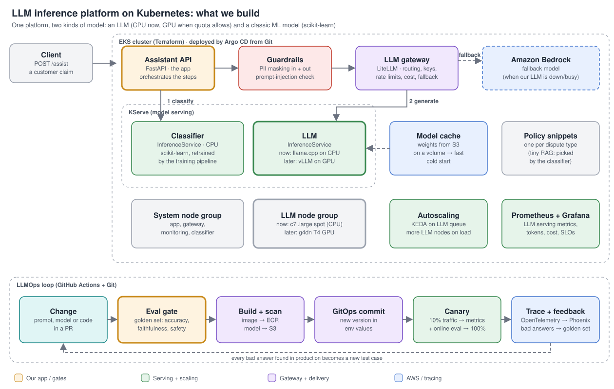
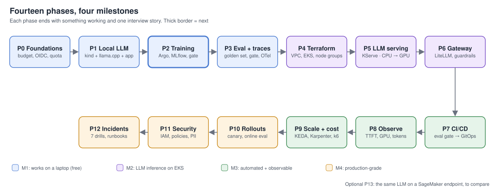

# LLM inference platform on Kubernetes: the plan

Written 2026-11-12. This is a new, standalone project. It replaces the earlier AWS plan (`aws-inference-platform-plan.md` in the starter-pack repo) by adding LLMOps and GPU inference to it.

> **Plan B is active (2026-11-13).** AWS refused the GPU quota (normal for new accounts). An appeal asking for 4 vCPUs has been reopened. Until a GPU is approved, **the LLM runs on CPU nodes**. Everything else in this plan stays the same. See §2a.

**One sentence:** we build a platform on AWS Kubernetes (EKS) that serves an open-source LLM on a GPU and a classic ML model on CPU, behind a gateway with guardrails, plus a **training pipeline** that retrains the classic model in pods and hands each new version to serving. It is shipped by an evaluation-gated CI/CD pipeline and watched by metrics, traces and alerts.

**Who this is for:** two kinds of job at once.

| Job type | Examples (Toronto, 2026) | What they ask for | Where this project covers it |
| --- | --- | --- | --- |
| **MLOps / inference platform** | Autodesk Senior MLOps Developer (Inference); "AI Platform Engineer" | Kubernetes, inference on pods, training infrastructure, Terraform, CI/CD, monitoring, security, incidents | P2, P4, P5, P7–P12 |
| **LLMOps / AgentOps / DevOps for AI** | RBC AI Platform roles; "LLMOps Engineer"; "Senior DevOps Engineer, AI Platform"; "Agent & DevOps Platform Engineer" | LLM serving, evaluation, tracing, guardrails, gateway, token cost, GPU | P1, P3, P5, P6, P8–P10 |

---

## 0. The idea in plain words

**The use case:** Maple Bank (fictional, synthetic data) gets customer dispute claims like *"I was charged twice at BestElectro for $49.99"*. Our system:
1. **classifies** the claim into one of 6 dispute types, using the scikit-learn model we already trained (B2);
2. **picks the bank's policy text** for that dispute type. This is a tiny form of **RAG** (retrieval-augmented generation: giving the LLM the facts it should use, instead of trusting its memory);
3. asks an **LLM** to draft a reply that follows that policy;
4. **checks** the input and output with guardrails (masks card numbers and names; blocks prompt-injection attempts);
5. returns the draft for a human agent to review.

**Why this shape:** it's small, but every hard part of production AI is in it.

| Production AI problem | Where it shows up here |
| --- | --- |
| Serving a big model on expensive GPUs | The LLM on a GPU node with vLLM |
| Serving a normal ML model cheaply | The classifier on CPU |
| Chaining models (a "compound AI system") | Classifier → policy → LLM |
| Is the answer *correct*, not just fast? | Evaluation gate + tracing |
| Cost per request | Tokens, GPU hours, cost per 1M tokens |
| Safety and privacy | Guardrails, PII masking, data residency (explained, see P11) |
| What if the GPU fails? | Gateway falls back to Amazon Bedrock |

**Key words used everywhere below:**

| Word | Meaning |
| --- | --- |
| **Inference** | Using a trained model to answer a request (vs training it) |
| **LLM** | Large language model. Ours is **Qwen2.5-1.5B-Instruct**: small (1.5 billion parameters), open-source (Apache 2.0), fits easily on one small GPU |
| **vLLM** | The most widely used open-source LLM server. Its tricks are *batching* (answering many requests together) and *KV cache* management (reusing work between tokens), which give much higher throughput than naive serving |
| **KServe** | A Kubernetes add-on for serving models. You describe a model in a short YAML file (an `InferenceService`) and KServe creates the pods, networking and autoscaling. It can run vLLM inside |
| **Token** | A piece of a word; LLMs read and write tokens. Cost and speed are measured in tokens |
| **TTFT** | *Time to first token*: how long until the answer starts appearing. The main latency number for LLMs |
| **Tokens/sec** | Throughput: how much text the server produces per second, across all users |
| **Gateway** | One front door for all LLM calls: picks the model, enforces rate limits and budgets, falls back on failure, records cost. We use **LiteLLM** |
| **Eval (evaluation)** | Automated tests for answer *quality*: a fixed set of questions (the **golden set**) with checks on each answer |
| **Tracing** | Recording every step of one request (classify → policy → LLM → guardrail) with timings and inputs/outputs, so you can see *why* an answer was bad |

---

## 1. What we build



**Journey 1: one request.**
1. A client sends `POST /assist` with a claim.
2. The Assistant API masks personal data, then calls the **classifier** (KServe, CPU).
3. It looks up the policy for that dispute type and builds the prompt.
4. It calls the **gateway**. The gateway sends the prompt to the **LLM** (KServe + vLLM on a GPU node). If the GPU is down or overloaded, the gateway falls back to a Bedrock model.
5. The output guardrail checks the answer (no leaked card numbers; it must cite the policy).
6. The response comes back. Every step is a span in one **trace**, and metrics are counted.

**Journey 2: one change.** A prompt, model or code change is opened as a PR.
1. CI runs the **eval gate**: the golden set must still pass.
2. The image is built, scanned and pushed.
3. A Git commit updates the version.
4. Argo CD deploys it as a **canary**: 10% of traffic, checked on latency, errors and an online quality score, then 100%.
5. Bad answers found in production become new golden-set cases.

**Journey 3: new training data.** The data team drops a new raw export in S3, or the drift alert (P8) says the live claims no longer look like the training data.
1. A training pipeline (Argo Workflows) runs each step as a pod: **prepare the raw drop → validate the data → train (scikit-learn and PyTorch candidates) → gate → compare with the production model → register in MLflow**.
2. Any failed step stops the pipeline; production keeps its current model.
3. A new champion is published as `model.joblib` + `metadata.json` (with checksum) to the model store.
4. A Git commit bumps the classifier's model version; Argo CD rolls it out; the classifier pod verifies the checksum before serving.

---

## 2. Design decisions, and why

| Decision | Choice | Why | What to say about the alternative |
| --- | --- | --- | --- |
| Kubernetes | **EKS** | Autodesk and most AWS shops; the JD asks for inference on Kubernetes | AKS/GKE are the same ideas. You already know Azure from Foundry |
| LLM server | **vLLM** | The industry default for open-source LLMs; exposes an OpenAI-compatible API and rich Prometheus metrics | TGI, TensorRT-LLM, Triton: "vLLM for flexibility; TensorRT-LLM when squeezing the last 30% from NVIDIA GPUs" |
| Model serving layer | **KServe** | Standard way to run many models on Kubernetes; supports vLLM and scikit-learn, canary traffic split, autoscaling | Plain Deployments work too. KServe is what platform teams use to serve *many teams'* models |
| GPU | **One spot g4dn.xlarge** (NVIDIA T4, 16 GB) that scales **from 0** | Cheapest NVIDIA GPU on AWS; enough for a 1.5B model. Scale-from-zero means no GPU cost when idle | A10G/L4 (g5/g6) or A100/H100 for big models. Same YAML, bigger node |
| Local development | **kind + Ollama** on your laptop | Free and fast. Ollama serves the same model with an OpenAI-compatible API, so app code doesn't change between laptop and EKS | — |
| Gateway | **LiteLLM** proxy | Open-source; routing, fallback, keys, budgets in one place | Cloud API gateways or Kong AI Gateway: same job |
| Fallback model | **Amazon Bedrock** | Managed LLMs on AWS; shows the "self-host vs managed API" trade-off | Azure OpenAI is the same idea; you've used it via Foundry |
| Tracing | **OpenTelemetry → Arize Phoenix** (one container, self-hosted) | OpenTelemetry is the standard; Phoenix is light and LLM-aware | Langfuse (heavier to self-host), LangSmith, Datadog LLM Observability |
| Evaluation | **pytest + a golden set**, with simple checks plus an LLM-as-judge for faithfulness | You understand every check; runs in CI | promptfoo, Ragas, DeepEval: same idea, packaged |
| Guardrails | **Microsoft Presidio** for PII + simple injection rules | Open-source, explainable | Bedrock Guardrails, NeMo Guardrails, Azure AI Content Safety |
| Delivery | **GitHub Actions + Argo CD (GitOps)** | Git is the record of what runs; rollback = revert | Flux; Jenkins/GitLab CI |
| Infrastructure | **Terraform** | A hard requirement in the JD | CloudFormation/CDK, Pulumi |
| Region | **us-east-1** (chosen 2026-11-13; GPU quota requested there) | Most GPU capacity, the widest choice of Bedrock models, the lowest prices | Canadian banks need **ca-central-1** for data residency. Same Terraform with a different region variable; say this in interviews |

---

## 2a. Plan B: CPU first, GPU when approved

**Why:** AWS refused the GPU quota (0 → 8 vCPUs) for this new account. That's a routine risk check. Our *normal* instance quota is **8 vCPUs on-demand + 8 spot**, so we design for that.

| Part | Plan B (now) | GPU upgrade (after quota approval) |
| --- | --- | --- |
| LLM | **Qwen2.5-0.5B-Instruct**, quantized to 4 bits (GGUF, about 0.4 GB) | Qwen2.5-1.5B-Instruct, fp16 |
| LLM server | **llama.cpp server**: fast on CPU, OpenAI-compatible API, Prometheus metrics with `--metrics` | **vLLM** (GPU batching, KV cache) |
| How it's served | KServe `InferenceService` with a custom container | KServe with the vLLM runtime |
| LLM nodes | **c7i.large** (2 vCPU, 4 GB) spot, **1 → 2** nodes | g4dn.xlarge (T4) spot, 0 → N |
| System nodes | **2× t3.large** (2 vCPU, 8 GB): Argo CD, KServe, monitoring, gateway, classifier | Same |
| vCPUs used | 4 (system) + 2–4 (LLM) = **at most 8**, which fits the current quota | + 4 per GPU node |
| Autoscaling signal | Requests waiting in the llama.cpp queue (KEDA) | Requests waiting in the vLLM queue (KEDA) |
| GPU metrics (DCGM) | Explained, not built | Built |

**What doesn't change:** Terraform, EKS, KServe, the gateway with Bedrock fallback, guardrails, the CI quality gate, tracing, Argo CD, canaries, monitoring, security and incident drills. Those are most of what the interviews ask about.

**How it's built to switch:**
- The app and gateway only see an OpenAI-compatible URL.
- Terraform has a `gpu_enabled` variable (default `false`).
- The LLM `InferenceService` has two values files: `cpu.yaml` and `gpu.yaml`.

So upgrading means turning on one variable, changing one values file, and running one Argo CD sync.

**Interview story this gives you:**
> "I designed the serving layer to be hardware-agnostic. While waiting for GPU quota, I ran a quantized 0.5B model with llama.cpp on CPU nodes. When the GPU arrived, I switched to vLLM by changing the node pool and the runtime, then measured CPU against GPU latency and cost per 1M tokens."

That's a realistic platform-team situation: capacity is never there when you want it.

**Cost now:** EKS $0.10 + 2× t3.large ~$0.17 + c7i.large spot ~$0.04 ≈ **$0.30–0.40/hour**. These are estimates.

**Quota follow-up:**
- An appeal for 4 vCPUs (G and VT on-demand, us-east-1) has been reopened.
- If it's refused again: ask again 2–4 weeks after the first paid invoice.
- If we need more than 8 normal vCPUs (e.g. scaling tests in P9), we request 16. Normal quotas are approved much more easily than GPU ones.

---

## 3. Cost and safety rules

- **Budget alarm first** (P0): email at $20 and $50.
- **Most work is free:** P1–P3 and much of P6–P7 run on your laptop.
- **On AWS, destroy after every session** with `terraform destroy`.
- **Rough cost while running** (estimates; we check current prices in P0):

| Item | ~Cost |
| --- | --- |
| EKS control plane | $0.10/hour |
| 2 small CPU nodes | ~$0.10/hour |
| GPU node (g4dn.xlarge) | ~$0.55/hour on-demand, often ~$0.20–0.30/hour as spot; **$0 when scaled to zero** |
| Bedrock fallback | Pennies (we send a handful of requests) |

  - A 3-hour session with the GPU on costs **about $1.50–2.50**.
  - **The whole project: roughly $40–80.**
- **GPU quota:** new AWS accounts usually have **0 GPU quota**. P0 requests it ("Running On-Demand G and VT instances" and the Spot equivalent, 8 vCPUs). Approval can take a day or more, so we ask early.
- **I ask before every `terraform apply`, `destroy`, and anything that costs money.** No long-lived keys: SSO for you, OIDC for GitHub, Pod Identity for pods.

---

## 4. Folder layout

```
llm-inference-platform/
├── docs/                 PLAN.md, phase notes, diagrams/
├── app/                  P1  Assistant API (FastAPI): guardrails, prompt, calls classifier + gateway
│   └── prompts/              versioned prompt files (prompt changes go through the eval gate)
├── models/classifier/    P1  the classifier's serving code (from P2 on, its weights come from the training pipeline)
├── training/             P2  trainer image (validate, train, register, publish), Argo WorkflowTemplate,
│                             local MinIO (S3 stand-in) + MLflow
├── evals/                P3  golden set (claims + expected type + must-mention facts) and eval runner
├── local/                P1  kind cluster config, Ollama, Phoenix: the free laptop stack
├── infra/                P0, P4  Terraform
│   ├── bootstrap/            budget, state bucket, GitHub OIDC role
│   └── platform/             VPC, EKS, CPU + GPU node groups, ECR, S3, IAM, Argo CD
├── deploy/               P5–P10  Helm charts and values per environment; KServe InferenceServices;
│                             gateway config; monitoring dashboards and alerts; Argo CD apps
├── loadtest/             P9  k6 scripts + results
├── runbooks/             P12 one page per incident + a postmortem
└── .github/workflows/        app, evals, infra pipelines
```

---

## 5. The phases



Each phase lists:
- **Goal**
- **Build:** what we make
- **New words:** explained when we get there
- **Done when:** a check you can see
- **Interview story:** what you can now say
- **Jobs:** which postings it speaks to

A phase is one or two 2–3-hour sessions.

### Milestone 1: works on a laptop (free)

#### P0: Foundations
- **Detailed plan:** [phases/p0-foundations.md](phases/p0-foundations.md)
- **Goal:** a safe AWS account and a repo, before any building.
- **Build:**
  - AWS SSO login.
  - Budget alarm.
  - Request the **GPU quota**.
  - Check which GPUs and Bedrock models are available in us-east-1.
  - Terraform state bucket with locking.
  - GitHub repo + OIDC role, all in `infra/bootstrap/`.
  - Install the local tools (Ollama, k6).
- **New words:** service quota, Terraform state, OIDC, least privilege.
- **Done when:** the GPU quota request is approved (or pending), the budget exists, and GitHub can assume its AWS role.
- **Interview story:** "Before any GPU work: cost guardrails, quota planning and keyless access."
- **Jobs:** all.

#### P1: The LLM app on a laptop
- **Goal:** the whole request path working locally on Kubernetes.
- **Build:**
  - a kind cluster;
  - Ollama serving `qwen2.5:1.5b` (OpenAI-compatible API);
  - the classifier as a small container;
  - the Assistant API (FastAPI) with `/assist`, `/healthz`, `/readyz` and `/metrics`;
  - prompts as versioned files in `app/prompts/`;
  - Helm charts for each piece.
- **New words:** prompt template, system prompt, temperature, OpenAI-compatible API, readiness vs liveness.
- **Done when:** `curl localhost/assist` returns a dispute type and a drafted reply that quotes the right policy.
- **Interview story:** "The app talks to an OpenAI-compatible endpoint, so the same code runs against Ollama on my laptop, vLLM on a GPU, or a managed API. Only the URL changes."
- **Jobs:** LLMOps, AgentOps.

#### P2: Training pipeline (retrain → gate → serve)
- **Detailed plan:** [phases/p2-training-pipeline.md](phases/p2-training-pipeline.md)
- **Goal:** the *training* half of an ML platform. New data goes in; a validated, versioned model comes out and reaches the serving pod with no manual steps in between.
- **Build (on kind, $0):**
  - **MinIO** as a local S3 (buckets for raw drops, datasets and models), and an **MLflow** server (tracking + registry) with a **PostgreSQL** database and its files in MinIO.
  - A **trainer image** with the B2 code: `validate.py`, `train.py`, MLflow tracking, champion/challenger promotion. Pinned library versions, the same as the serving image.
  - A **prepare** step (data processing): a raw CSV export → cleaned, deduplicated, split into train/val/test, with a versioned manifest.
  - **Two model families compete:** scikit-learn (TF-IDF + logistic regression, from B2) and a small **PyTorch** text classifier, both on CPU. The better one on validation goes on to the gate. This shows the pipeline doesn't care which framework a team uses.
  - An **Argo Workflows** `WorkflowTemplate`: prepare → validate → train + gate → compare with the champion → publish. Each step is a pod; a failed step stops the run. Parameterised (raw file, model name), so another team could reuse it.
  - The **classifier pod loads its weights from the model store** (init container) instead of having them baked into the image. The model version is a Helm value, so a new model ships the same way as a new image tag.
  - Drills: a broken dataset is stopped at validation; a worse model is trained but not promoted.
- **Later, on EKS:** the same workflow with S3 instead of MinIO, Pod Identity instead of keys, and training pods on spot nodes that scale to zero (P5). A new dataset in S3 triggers it (P7).
- **Optional, after GPU approval:** a LoRA fine-tune of Qwen as a GPU Job, with checkpoints in S3 so a spot interruption resumes instead of restarting.
- **New words:** Kubernetes Job, Argo Workflows, WorkflowTemplate, data preparation (ETL), artifact store, model registry, champion/challenger, PyTorch, init container, retraining trigger.
- **Done when:** one `argo submit` turns a raw export into a registered, published model version, with both model families visible in MLflow; the classifier serves it after a values bump; the broken-data and worse-model drills both stop where they should.
- **Interview story:** "Training runs as a pipeline of pods: raw data is prepared and versioned, validation fails fast, scikit-learn and PyTorch candidates compete, the candidate must pass absolute thresholds and beat the production model, and only then is it registered and published with a checksum. Serving pulls an exact version, so every prediction traces back to a dataset and a commit."
- **Jobs:** Autodesk ("infrastructure for model training"), MLOps, AI platform.

#### P3: Evaluation and tracing
- **Goal:** measure answer *quality*, and see inside every request.
- **Build:**
  - A **golden set** of about 60 claims. Each has an expected dispute type, facts the reply must mention, and things it must never do (e.g. promise a refund, repeat a card number).
  - An eval runner that scores classification accuracy, a policy-faithfulness check (rules + an LLM-as-judge), safety checks, and latency.
  - A **gate**: thresholds that fail the run.
  - OpenTelemetry tracing into Phoenix: one trace per request, one span per step.
- **New words:** golden set, LLM-as-judge, faithfulness / hallucination, regression, span, trace.
- **Done when:** a deliberately worse prompt fails the gate, and you can open the trace of a bad answer and see which step caused it.
- **Interview story:** "A prompt change is a code change. It doesn't ship unless the golden set still passes. When an answer is wrong in production, the trace shows whether retrieval, the model or the guardrail caused it."
- **Jobs:** LLMOps (core).

### Milestone 2: LLM inference on EKS (CPU now, GPU after quota approval)

#### P4: The platform in Terraform
- **Goal:** one `terraform apply` builds the AWS side; one `destroy` removes it.
- **Build:**
  - VPC;
  - EKS with a **system node group** (2× t3.large) and an **LLM node group**: c7i.large spot, 1–2 nodes, with a *taint* so only LLM pods land there. Plan B. A **GPU node group** (spot g4dn, min 0) is in the code behind `gpu_enabled = false`;
  - ECR;
  - S3 buckets for model weights and for training data (versioned, KMS);
  - Pod Identity roles (LLM pods read weights; training pods read datasets and write models);
  - **RDS PostgreSQL** (smallest instance) as MLflow's database, in private subnets, encrypted;
  - Argo CD installed by Terraform.
- **New words:** node group, taint/toleration, spot instance, EKS accelerated AMI, Terraform module.
- **Done when:** the cluster is up, and a test pod with the LLM toleration lands only on the LLM node group. After GPU approval: a GPU pod runs `nvidia-smi` and the GPU node scales back to 0 afterwards.
- **Interview story:** "GPU nodes are tainted and scale from zero, so we only pay for a GPU while a model needs one."
- **Jobs:** MLOps inference (Autodesk), AI platform.

#### P5: Serving the models with KServe
- **Goal:** both models served on Kubernetes the way a platform team would do it.
- **Build:**
  - Install KServe.
  - Classifier `InferenceService` on CPU, loading the champion version from the S3 model store.
  - The P2 training pipeline moved to EKS: Argo Workflows, S3 instead of MinIO, training pods on spot nodes that scale to zero, MLflow on RDS with its artifacts in S3.
  - **A platform for many teams, not one app:** a namespace per team (`team-disputes`, plus a second example team) with a **ResourceQuota** (CPU, memory, GPU caps), and **PriorityClasses** so serving pods win over training pods when the cluster is full (training is retried; customers aren't kept waiting). The training WorkflowTemplate is shared, so a team submits a run with its own parameters instead of building its own pipeline.
  - LLM `InferenceService`. **Plan B:** llama.cpp server with Qwen2.5-0.5B (4-bit GGUF) on the LLM CPU nodes. **After GPU approval:** vLLM with Qwen2.5-1.5B on the GPU node; the T4 doesn't support bfloat16, so we set `dtype=half`.
  - Model weights pre-staged in S3 and cached on a volume, which cuts **cold start** (time from "pod scheduled" to "ready to answer").
  - (After GPU approval) the NVIDIA device plugin and the **DCGM exporter** for GPU metrics.
  - Measure TTFT, tokens/sec, and memory use. After the GPU upgrade, measure again and compare CPU vs GPU.
- **New words:** InferenceService, serving runtime, cold start, KV cache, batching, `max_model_len`, GPU memory utilization, DCGM, multi-tenancy, ResourceQuota, PriorityClass, preemption.
- **Done when:** both models answer through KServe, and you have a table of cold-start time, TTFT and tokens/sec.
- **Interview story:** "Cold start was N minutes because the pod downloaded 3 GB of weights from Hugging Face. Pre-staging in S3 with a cache brought it down to M." (We measure the real numbers.)
- **Jobs:** Autodesk (core), AI platform, LLMOps.

#### P6: Gateway and guardrails
- **Goal:** one controlled front door for all LLM traffic.
- **Build:**
  - LiteLLM proxy: route to self-hosted vLLM, fall back to Bedrock on errors or timeouts, per-client API keys, rate limits, budgets.
  - Presidio PII masking on input and output.
  - Simple prompt-injection rules.
  - Token and cost metrics.
- **New words:** fallback, rate limit, token budget, PII, prompt injection, defence in depth.
- **Done when:** scaling the GPU deployment to 0 makes requests fall back to Bedrock (slower, but they keep working), and a claim with a card number never shows the number in logs or answers.
- **Interview story:** "When the GPU pool was unavailable, the gateway failed over to Bedrock automatically. Users saw slower answers, not errors."
- **Jobs:** LLMOps, AgentOps, banks (privacy).

### Milestone 3: automated and observable

#### P7: CI/CD with an eval gate
- **Goal:** prompt, model and code changes reach prod only through gates, with no manual deploys.
- **Build:** GitHub Actions.
  - **app pipeline:** test → build → Trivy scan → push to ECR.
  - **eval pipeline:** on any change to `app/prompts/`, the model version or the app, run the golden set against a test deployment and fail on regression. Post the score as a PR comment.
  - **promotion:** a GitOps commit to staging values, then a PR for prod (the approval).
  - **infra pipeline:** `terraform plan` on PR, `apply` on approval.
  - **training pipeline:** the trainer image is built and scanned in CI; a new dataset version in S3 triggers the training workflow (Argo Events); a newly promoted champion opens a PR that bumps the classifier's model version.
- **New words:** eval gate in CI, immutable image tag, GitHub environments, required reviewers.
- **Done when:** a PR with a worse prompt is blocked with the score in a comment, and a good PR reaches staging by itself.
- **Interview story:** "Our pipeline treats prompts and model versions like code: the eval score is a required check on every PR."
- **Jobs:** all (CI/CD is deep in every JD).

#### P8: Observability
- **Goal:** know within minutes when the system *or the answers* go wrong.
- **Build:**
  - Prometheus + Grafana.
  - Dashboards for:
    - **LLM serving:** TTFT, tokens/sec, requests waiting, KV-cache use (vLLM metrics);
    - **GPU:** utilisation, memory, temperature (DCGM);
    - **gateway:** tokens and cost per client, fallback rate;
    - **app:** RED metrics (rate, errors, duration) and dispute-type mix;
    - **quality:** online eval score on sampled traffic.
  - **SLOs**, e.g. p95 TTFT < 1.5 s and 99% success, with alerts.
  - **Logs:** the services write structured JSON logs (one line per request, with trace ID, model and prompt version, never the claim text). **Fluent Bit** ships them to **Loki**, searchable in Grafana next to the metrics. Same job as the ELK stack (Elasticsearch, Logstash, Kibana), cheaper to run.
  - **Model performance and drift (classifier):** the live label mix and the confidence distribution compared with the training data. When they move too far apart (data drift), an alert fires, and it can start the P2 training pipeline: the monitoring → retraining loop.
- **New words:** SLO / SLI / error budget, RED metrics, PromQL, sampling, structured logging, Loki / ELK, data drift, PSI (population stability index).
- **Done when:** the dashboards show live traffic; an alert fires when TTFT breaks its SLO under load; one request can be followed from its log line to its trace; and sending December-style claims to the November model raises the drift alert.
- **Interview story:** "For LLMs I watch three layers: infrastructure (GPU), serving (TTFT, queue), and quality (eval score on sampled traffic). Any one can fail while the others look fine."
- **Jobs:** all (monitoring is deep in the Autodesk JD).

#### P9: Autoscaling, performance and cost
- **Goal:** know the limits, scale on the right signal, and know the cost per request.
- **Build:**
  - k6 load test.
  - Find one GPU's capacity (requests and tokens/sec at an acceptable TTFT).
  - **KEDA** scales the LLM on *requests waiting in the vLLM queue*, not CPU (CPU says nothing about GPU load).
  - **Karpenter** adds and removes GPU nodes.
  - Compare settings: max batch size, `max_model_len`, and optionally a quantized model (smaller numbers, less memory, a bit less accuracy).
  - Compute **cost per 1M tokens**: self-hosted vs Bedrock.
- **New words:** throughput vs latency trade-off, queue depth, KEDA, Karpenter, quantization, cost per token.
- **Done when:** under a load ramp, LLM replicas and GPU nodes scale out and back in, and you have a self-host vs managed cost table.
- **Interview story:** "CPU-based autoscaling never triggered because the bottleneck was the GPU queue. Scaling on vLLM's waiting-requests metric kept TTFT inside the SLO. At our volume, self-hosting is cheaper above X requests a day; below that, Bedrock wins."
- **Jobs:** Autodesk (scaling is core), AI platform.

### Milestone 4: production-grade

#### P10: Safe rollouts for models and prompts
- **Goal:** a bad model or prompt can't hurt everyone.
- **Build:**
  - KServe canary for a new model version (`canaryTrafficPercent`). A new prompt version gets a canary via the app's version routing.
  - **Shadow mode:** send copies of real requests to the new version without returning its answers, and compare.
  - Promotion rules based on latency, errors and the online eval score.
  - Drill: release a prompt that hallucinates refunds and watch it get stopped.
- **New words:** canary, shadow traffic, A/B test, online evaluation, rollback.
- **Done when:** the bad version is stopped at 10% and rolled back, with the timeline captured.
- **Interview story:** "The new prompt passed offline evals but failed on real traffic patterns. The canary's online eval score dropped and we rolled back at 10% exposure."
- **Jobs:** all.

#### P11: Security and governance
- **Goal:** would pass a bank's review.
- **Build:**
  - Least-privilege Pod Identity (the LLM pods read only the weights bucket).
  - KMS encryption.
  - Secrets from AWS Secrets Manager via External Secrets (the gateway keys).
  - NetworkPolicies: only the app talks to the gateway; only the gateway talks to the LLM.
  - **Team isolation:** each team's namespace has its own service accounts and RBAC; one team can't read another team's models, data or secrets.
  - Pod Security `restricted`.
  - Image scanning; model weights verified by checksum (provenance).
  - Audit log of prompts and versions, with PII masked.
  - Data residency: be able to explain how a Canadian bank would pin everything, Bedrock included, to ca-central-1, and what that limits (fewer models, less GPU capacity).
- **New words:** model provenance, supply chain, NetworkPolicy, External Secrets, data residency.
- **Done when:** a pod in another namespace can't call the LLM, and no secret exists in Git or in plain Kubernetes manifests.
- **Interview story:** "Every prompt and response is auditable without storing personal data: PII is masked before logging."
- **Jobs:** banks, Autodesk (security is in the JD).

#### P12: Incident drills
- **Goal:** real troubleshooting stories, rehearsed. Each drill gets a runbook page; one gets a full blameless postmortem.
- **Drills:**
  1. **GPU out of memory:** `max_model_len` too high → vLLM fails to start.
  2. **Cold-start timeout:** readiness probe too short for model loading → restart loop.
  3. **Spot GPU interruption:** the node disappears → fallback to Bedrock, then recovery.
  4. **Latency spike under load:** queue grows → autoscaling, and why it took N minutes.
  5. **Bad prompt release:** caught by the canary.
  6. **Token cost spike:** one client loops → budget limit stops it.
  7. **Expired or missing permission:** pod can't read the weights from S3.
- **New words:** runbook, MTTD/MTTR, blameless postmortem, CrashLoopBackOff, OOMKilled.
- **Done when:** seven runbooks, and you can tell any of them in 2 minutes as a STAR story.
- **Jobs:** all (incident response is deep in the Autodesk JD).

#### P13 (optional): SageMaker comparison
Deploy the same LLM to a SageMaker real-time endpoint (vLLM / LMI container) with Terraform, for a day. Write the comparison: control, cost, effort, and when to choose each. This gives an honest answer to "have you used SageMaker?", which matters for Autodesk.

---

## 6. Milestones and pace

| Milestone | Phases | Sessions | Cost | What you can say |
| --- | --- | --- | --- | --- |
| M1 Works on a laptop | P0–P3 | 6–7 | ~$0 | "I built an LLM app on Kubernetes, a training pipeline that feeds it new model versions, and an eval gate with tracing" |
| M2 LLM inference on EKS (CPU → GPU) | P4–P6 | 5–6 | ~$15–25 | "…serving an LLM with vLLM and KServe on EKS GPU nodes, behind a gateway with fallback and guardrails" |
| M3 Automated + observable | P7–P9 | 5–6 | ~$15–30 | "…eval-gated CI/CD, GPU and LLM dashboards with SLOs, queue-based autoscaling, cost per token" |
| M4 Production-grade | P10–P12 | 4–5 | ~$10–20 | "…canary releases for prompts and models, hardened for a bank, seven incident drills" |

**Order:**
- **Before 17 Nov:** Autodesk HR prep comes first. P0 can run in parallel, because the GPU quota request takes time.
- **Then** M1 → M4. Every milestone is a complete, true story on its own.
- **Track the work like a team would:** a GitHub Projects board (the free equivalent of Jira) with one issue per phase, worked in short sprints. Interview answer to "how do you track work?" and "have you used Agile?".

---

## 7. How it maps to the Autodesk JD

| Autodesk JD requirement | Phase |
| --- | --- |
| Kubernetes + Docker for ML workloads, scaling | P1, P4, P5, P9 |
| Scalable infrastructure for model training, inference **and data processing** | P2 (prepare + training pipeline on kind), P5 (on EKS, spot nodes, quotas per team), P7 (triggered retraining); optional GPU fine-tune |
| An ML **platform** shared by many research and product teams | P5 (namespaces, quotas, priorities, shared pipeline template), P11 (team isolation) |
| Inference (title of the job) | P5, P9, P10 |
| CI/CD and automated deployment for ML models | P7, P10 |
| Terraform (minimum requirement) | P0, P4, P7 |
| Monitoring and logging of systems and models (Prometheus, Grafana, ELK) | P8: metrics, SLOs, Fluent Bit → Loki logs, classifier drift |
| Incident response, troubleshooting | P12 |
| Security, access control, privacy | P6, P11 |
| Model versioning, governance | P2 (MLflow registry, champion/challenger, checksums), P3, P7, P11 |
| AWS (preferred) | Everything from P4; P13 for SageMaker |
| SQL / NoSQL / data lakes (preferred) | PostgreSQL for MLflow (P2, RDS in P4); S3 as a versioned dataset store, i.e. a small data lake (P2, P4) |
| TensorFlow / PyTorch (preferred) | P2: a PyTorch candidate model in the training pipeline; vLLM (PyTorch) on GPU later |
| Git, Jira, Agile (preferred) | Everything in Git (GitOps); GitHub Projects board, one issue per phase, sprints |
| GPUs (on your resume) | P4, P5, P8, P9: real hands-on GPU work, so resume claims are defensible |

---

## 8. What we skip

| Topic | Why | One-line answer if asked |
| --- | --- | --- |
| Training an LLM from scratch | Only a few labs do this; it costs millions. We train the classic model ourselves (P2) and can fine-tune Qwen with LoRA once a GPU is approved | "Companies start from a pretrained model. My platform runs the training jobs, and their output arrives as new weights that go through the same gates and canary" |
| Big models (70B), multi-GPU, MIG | Cost | "Same platform: bigger GPU nodes, tensor parallelism in vLLM, and MIG to split one A100/H100 between small models" |
| Full RAG with a vector database | Adds a data pipeline, not platform skill | "Retrieval is one more traced, evaluated step. Here it's a lookup; in production it's a vector DB like pgvector or OpenSearch" |
| Multi-agent frameworks | AgentOps covered by tracing, guardrails, budgets | Your Foundry agent project covers agent hosting |
| Multi-account, private networking | Cost | "In production: separate accounts per environment, private subnets, VPC endpoints" |

---

## 9. What I need from you to start P0

- [ ] An AWS account with MFA on the root user. You agree that I can run AWS CLI commands through your SSO login; I ask before anything that creates resources or costs money.
- [ ] The budget alert email. (Region decided: **us-east-1**.)
- [ ] A **new GitHub repo** for this project, e.g. `llm-inference-platform`. Argo CD has to read it, so it should be public or have a read-only deploy key.
- [ ] OK for me to `git init` this folder and connect it to that repo. I only commit or push when you ask.
