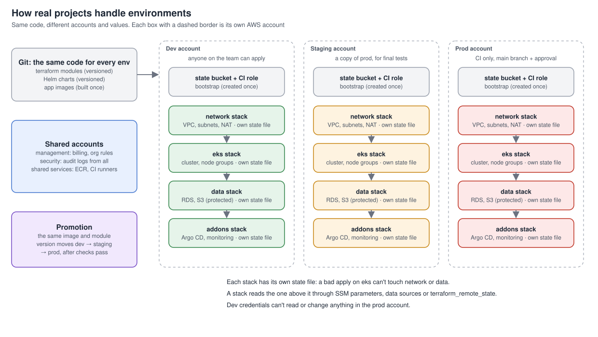

# How real projects handle environments (dev, staging, prod)

A short study note: how companies run the same platform several times without the copies hurting each other, and how our project compares.

---

## 1. What an environment is

An **environment** is a full, separate copy of the platform for one purpose:

| Environment | Used for | Who can change it |
| --- | --- | --- |
| **Dev** | Trying things out; it's fine if it breaks | The whole team |
| **Staging** | A copy of prod for final tests before release | CI, after review |
| **Prod** | Real customers | CI only, from the `main` branch, with an approval |

**The rule:** every environment runs **the same code**. Only the *values* differ (size, number of nodes, domain names). So if it works in staging, it works in prod.

---

## 2. One AWS account per environment

Dev, staging and prod each live in their **own AWS account**, grouped under **AWS Organizations** (AWS's way to manage many accounts together).

**Why separate accounts:** an account is the strongest wall AWS has. Each one has its own permissions, limits and bill. A mistake or a leaked key in dev can't touch prod.

A few extra accounts are shared by everyone:

| Shared account | Holds |
| --- | --- |
| **Management** | Billing and organisation-wide rules (**SCPs**: policies no one in any account can break, e.g. "never turn off audit logs") |
| **Security / log archive** | Audit logs from every account, which most people can only read |
| **Shared services** | ECR (container images), CI runners, sometimes the Terraform state |

---

## 3. Terraform: split into stacks, one state file each

A **stack** is one folder you run `terraform apply` in. Each stack keeps its own **state file** (Terraform's record of what it built). Each environment has the same set of stacks:

| Stack | Builds | Changes |
| --- | --- | --- |
| **bootstrap** | the state bucket and the CI role for that account | once |
| **network** | VPC, subnets, NAT | rarely |
| **eks** | cluster, node groups | sometimes |
| **data** | RDS, S3 buckets | rarely, and protected from deletion |
| **addons** | Argo CD, monitoring | often |

**Why split:** a bad `apply` can only break the stack it ran on. A mistake in `addons` can't delete the database. Plans are faster too, and two teams can work on different stacks at the same time.

**Where the state files live:** each environment's state stays in that environment's account (or in the shared-services account). Either way, **dev credentials can never read or change prod state**. This matters because state files can contain secrets.

---

## 4. When one stack needs something from another

The `eks` stack needs the VPC ID that the `network` stack created. Four common ways to pass it:

| Way | How it works | Good to know |
| --- | --- | --- |
| `terraform_remote_state` | `eks` reads `network`'s state file directly | Simple, but `eks` can then read *everything* in that state, secrets included |
| **SSM Parameter Store** | `network` saves `/prod/network/vpc_id`; `eks` reads that one value | A clean contract between teams; a popular choice |
| **Data source** | `eks` looks the VPC up in AWS by its tags | No access to other state files needed |
| **Terragrunt dependency** | A tool that passes one stack's outputs into another | Common when there are many stacks |

---

## 5. Where everything else lives

| Thing | Where | Per environment? |
| --- | --- | --- |
| Terraform **modules** (building blocks) | Their own repo, released with versions (`v1.4.0`) | No: each environment *picks* a version |
| Terraform **live config** (which modules, which values) | An `infra-live` repo, one folder per environment and stack | Yes |
| **Helm charts** (templates) | A charts repo, published to a chart registry (often ECR) | No: versioned |
| **Helm values + image tags** | A **GitOps repo**, one folder per environment | Yes |
| **Argo CD** | Installed in each cluster; watches its environment's folder in the GitOps repo | Yes |
| **App images** | Built **once**, stored in ECR | No: the same image moves dev → staging → prod |

---

## 6. Promotion: moving a change towards prod

1. A change is merged. CI builds the image once and tags it with the git commit (e.g. `a1b2c3d`).
2. **Dev:** the GitOps repo's dev folder gets the new tag; Argo CD deploys it.
3. **Staging:** after dev checks pass (and, for us, the eval gate), a PR updates the staging folder.
4. **Prod:** after staging passes and someone approves, a PR updates the prod folder; Argo CD deploys it, often as a canary first.

Infrastructure moves the same way: a new module version is used in dev first, then staging, then prod.

**Rollback** = revert the PR in the GitOps repo. Argo CD puts the old version back.

---

## 7. Our project compared

| Real project | Ours (one person, one budget) |
| --- | --- |
| Dev, staging, prod accounts | One account, one environment |
| bootstrap, network, eks, data, addons stacks | Two stacks: `bootstrap` (stays) and `platform` (everything else, destroyed after each session) |
| One state file per stack per environment | `bootstrap/terraform.tfstate` and `platform/terraform.tfstate` in one bucket |
| Modules in a versioned repo | Community modules pinned by version (`vpc 6.7.3`, `eks 21.29.0`) |
| Separate charts and GitOps repos | Folders in one repo (`deploy/charts/`, `deploy/local/`) |

The ideas are the same; ours is the small version.

### Interview version

> "Each environment is its own AWS account under Organizations, running the same Terraform and Helm code with different values. Infrastructure is split into stacks (network, EKS, data, add-ons), each with its own state in that account, so a bad apply has a small blast radius and dev can never touch prod. Stacks share outputs through SSM parameters rather than reading each other's state. Images are built once and promoted dev → staging → prod by PRs to a GitOps repo that Argo CD syncs."
