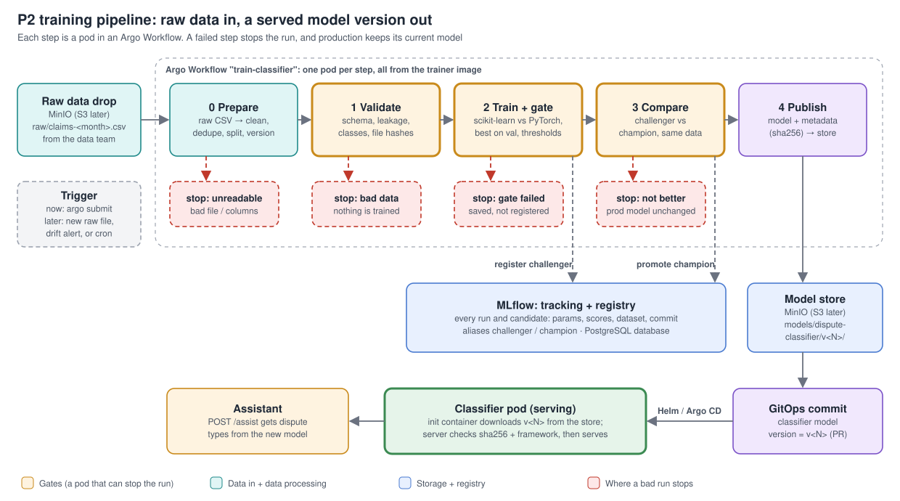

# P2: Training pipeline (retrain → gate → serve)

Part of [PLAN.md](../PLAN.md) §5. **Status (2026-11-13): planned.** **Cost: $0.** Everything runs in the same kind cluster as P1.

**Goal:** the *training* half of the platform. A raw data export goes in; a validated, versioned model comes out and reaches the classifier pod, with every step automated and every bad run stopped before production.



**What changes for P1:** today the classifier's `model.joblib` is copied by hand from the B2 folder and baked into the image. After P2 it is **produced by the pipeline and pulled at startup**, so the image holds only serving code, and a new model ships by changing one Helm value.

---

## What we build

| Piece | What it is | Runs as |
| --- | --- | --- |
| **MinIO** | An S3-compatible store, our laptop stand-in for S3. Buckets: `raw` (the data team's exports), `datasets` (prepared, versioned datasets), `mlflow` (MLflow's files), `models` (published models), `argo` (files passed between pipeline steps) | Deployment + volume, namespace `mlops` |
| **PostgreSQL** | MLflow's database: runs, metrics, model versions, aliases. A real SQL database instead of SQLite, as in production (RDS on EKS) | Deployment + volume, namespace `mlops` |
| **MLflow server** | Tracking (every run's settings and scores) and the **registry** (model versions with the aliases `challenger` and `champion`). Database: PostgreSQL; files in MinIO | Deployment, namespace `mlops` |
| **Argo Workflows** | Runs pipelines on Kubernetes, one pod per step, steps in order; a failed step stops the run | Helm chart, namespace `argo` |
| **Trainer image** (`trainer:dev`) | The B2 code (`validate.py`, `train.py`, MLflow tracking, `registry.py`) plus new `prepare.py`, a PyTorch candidate (`torch_model.py`) and `publish.py`. Pinned scikit-learn 1.6.1 and CPU-only PyTorch, the same versions as the serving image | Used by every pipeline step |
| **WorkflowTemplate** `train-classifier` | The pipeline definition: `prepare → validate → train → compare → publish`. Inputs: the raw file and the model name, so another team could reuse it | A Kubernetes object; `argo submit --from workflowtemplate/train-classifier` runs it |
| **Classifier, changed** | An **init container** downloads `models/dispute-classifier/v<N>/` before the server starts; the server verifies the checksum as before. The image no longer contains the model | The P1 chart, one new value: `modelVersion` |

---

## New words

| Word | Meaning, with our example |
| --- | --- |
| **Data preparation (ETL)** | *Extract, transform, load*: turning a raw export into training-ready data. Ours: read the CSV, trim whitespace, drop duplicates and unreadable rows, split into train/val/test by label, write parquet + a manifest whose version is a hash of the content |
| **PyTorch** | The most used deep-learning framework (with TensorFlow). Our PyTorch candidate is tiny: word pieces → an averaged embedding → a linear layer (an `EmbeddingBag` classifier). It trains on CPU in a few minutes |
| **Model family / framework** | scikit-learn and PyTorch models are saved and loaded differently. `metadata.json` records the `framework`, so serving knows how to load it; in P5, KServe picks a serving runtime from this "model format" |
| **Kubernetes Job** | A pod that runs to completion and exits (vs a Deployment, which runs forever). Training is a Job; serving is a Deployment |
| **Argo Workflows** | A Kubernetes add-on that chains Job-like steps into a pipeline (a DAG, *directed acyclic graph*: steps with "runs after" arrows and no loops). Kubeflow Pipelines and Airflow do the same job; Argo is the most Kubernetes-native and pairs with Argo CD |
| **WorkflowTemplate** | A reusable pipeline definition stored in the cluster. Each run is a `Workflow` created from it, with its own parameters (here: the dataset version) |
| **Artifact (Argo)** | A file or folder one step hands to the next, stored in MinIO/S3 in between, because each step is a different pod with its own disk. Our `train` step outputs the model package; `publish` receives it |
| **Artifact store** | Where files live (MinIO now, S3 on EKS). Different from the registry: the store holds bytes; the registry holds *which version is which* |
| **Model registry** | A catalogue of model versions with their scores, data version and commit. MLflow's registry, already used in B2 |
| **Champion / challenger** | Aliases in the registry. *Challenger* = newest version that passed the gate. *Champion* = the version production should serve. Promotion moves the `champion` alias only if the challenger is at least as good |
| **Init container** | A container that runs to completion **before** the main container starts, in the same pod. Ours downloads the model into a shared `emptyDir` volume |
| **Retraining trigger** | What starts a run. Now: a person runs `argo submit`. On EKS: a new dataset landing in S3 (Argo Events) or a schedule (`CronWorkflow`) |
| **Data drift** | The real-world inputs change over time (new merchants, new wording), so a model trained on old data gets worse. The reason retraining pipelines exist |

---

## One run, step by step

Input: `raw=claims-2026-11.csv` (the B2 November data exported as one raw CSV, with some duplicates and messy rows added, the way real exports arrive).

| Step | Pod runs | Reads | Writes | Stops the run when |
| --- | --- | --- | --- | --- |
| **0 prepare** | `prepare.py` | the raw CSV from `raw/` | `datasets/claims/<version>/` (train/val/test parquet + manifest); counts of rows dropped and why | the file can't be parsed, required columns are missing, or more than 5% of rows are unusable |
| **1 validate** | `validate.py` | the prepared dataset | nothing | schema wrong, too few rows, a label missing, a class under 8%, text shared between splits (leakage), file hash ≠ manifest |
| **2 train** | `train.py` | the dataset | trains the **scikit-learn** settings and the **PyTorch** candidate, picks the best on validation; model package (Argo artifact); MLflow run with every candidate; registers a **challenger** if the gate passes | the gate fails: macro-F1 < 0.90, a language < 0.85, any label's recall < 0.80 |
| **3 compare** | `registry.py promote` | MLflow: challenger and champion | moves `champion` to the challenger | the challenger is worse than the champion on any compared score. If they were trained on different data, both are re-scored on the shared **golden** set |
| **4 publish** | `publish.py` | the model package | `models/dispute-classifier/v<N>/model.joblib` + `metadata.json` (with `file_sha256` and `registry_version: N`) | the upload fails |

Then, outside the pipeline (as it would be in production): bump `modelVersion: v<N>` in `deploy/local/classifier.yaml` → `make deploy` → the init container pulls v<N> → the server verifies the checksum → ready. In P7 a bot opens this change as a PR, and Argo CD applies it.

---

## Design choices worth defending

| Choice | Why |
| --- | --- |
| **Each step is its own pod; files pass through the artifact store** | A step can be retried alone (a spot node dies during training: retry `train`, don't redo `validate`). The store keeps every step's output for later debugging |
| **Prepare is a pipeline step, not a script on someone's laptop** | Every dataset version is produced by the same code from a raw file that is kept, so any model can be traced back to the raw export it came from |
| **Two frameworks compete in the same pipeline** | Research teams use different frameworks. The platform's job is the same either way: run it, score it on the same data, gate it, version it. Honest expectation: the TF-IDF model probably wins on this small, template-like data, and that is a fine result. The point is that the decision is measured, not assumed |
| **If PyTorch wins, serving must load PyTorch** | The serving image gains CPU-only PyTorch (about 200 MB more). That's a real platform trade-off: one image per framework, or one larger image. We record `framework` in `metadata.json`, and the server refuses a framework it doesn't support (fail closed) |
| **MLflow on PostgreSQL, not SQLite** | SQLite allows one writer at a time and lives inside one pod. PostgreSQL is what production uses (RDS on EKS), handles concurrent runs from many teams, and can be backed up |
| **Validation and the gate are separate steps** | Validation catches *broken* data (wrong schema, leakage). The gate catches data that is *valid but bad*: our noisy dataset passes every validation check but produces a model with macro-F1 0.70. You need both |
| **Promotion compares against the champion, not only fixed thresholds** | A model can pass "≥ 0.90" while being worse than the 0.98 already in production. Never ship a regression just because it clears the bar |
| **The serving image holds no model** | One image serves any model version: a model change becomes a config change (Helm value), reviewed and rolled back like any other. Images stay small, and rebuilding is not needed for a retrain |
| **The checksum is still verified at load** | The download could be corrupted or tampered with. The pod refuses a file that doesn't match its `metadata.json` (pickles can run code) |
| **Training and serving pin the same library versions** | A model pickled with scikit-learn 1.6.1 must be loaded with 1.6.1 |
| **Code commit is baked into the trainer image** (build argument) | The container has no `.git` folder. The image tag and the recorded commit tie every model to the exact code that produced it |
| **MinIO credentials are generated locally, never committed** | The Makefile creates a random password in a Kubernetes Secret. On EKS there are no passwords at all: pods get IAM roles via Pod Identity |

---

## Files

```
training/
├── Dockerfile                 trainer image: python 3.11-slim, pinned libs, uid 10001, GIT_COMMIT build arg
├── requirements.txt           pandas, pyarrow, pandera, scikit-learn 1.6.1, joblib, torch (CPU), mlflow 3.1.4, boto3, psycopg2
├── src/                       copied from B2 with small changes:
│   ├── generate_claims.py         (only LABELS + content_hash are used, by validate.py and prepare.py)
│   ├── prepare.py             NEW: raw CSV → cleaned, split, versioned dataset
│   ├── validate.py
│   ├── torch_model.py         NEW: the PyTorch candidate (fit / predict_proba like scikit-learn)
│   ├── train.py                   code commit from GIT_COMMIT; PyTorch joins the candidates
│   ├── tracking.py
│   ├── registry.py                dataset folders from DATA_ROOT
│   └── publish.py             NEW: package → models/dispute-classifier/v<N>/
├── workflow.yaml              WorkflowTemplate train-classifier
├── mlops.yaml                 MinIO + PostgreSQL + MLflow (Deployments, Services, volumes)
├── argo-values.yaml           Argo Workflows Helm values (artifact repository = MinIO)
├── make_raw_drops.py          turns the B2 datasets into raw CSV exports (with duplicates and messy rows)
├── raw/                       NOT committed: the raw CSV drops, uploaded to MinIO as "data team exports"
└── tests/                     unit tests for publish.py and the changed bits
models/classifier/             Dockerfile no longer copies the model; loads by `framework`; tests keep a fixture copy
deploy/charts/service/         + optional init container
deploy/local/classifier.yaml   + modelVersion, init container that downloads the model
Makefile                       + mlops, datasets, train, train-status targets
```

---

## Steps

All local; nothing costs money. Installing Argo Workflows downloads its Helm chart and images.

1. **Storage + registry:** deploy MinIO, PostgreSQL and MLflow into `mlops`; create the buckets.
2. **Raw drops:** `make raw-drops` turns the four B2 datasets (`claims` Nov, `claims-dec`, `claims-noisy`, `golden`) into raw CSV exports with some duplicates and messy rows, and uploads them to `raw/`. This plays the data team.
3. **Trainer image:** copy the B2 code, make the small changes, add `prepare.py` and the PyTorch candidate, build `trainer:dev`, load into kind.
4. **Argo Workflows:** install with Helm; point its artifact repository at MinIO.
5. **The pipeline:** apply `workflow.yaml`; run it on the November raw drop. Expect both families in MLflow, v1 to become champion, and v1 to be published.
6. **Serving from the store:** change the classifier to pull `v1` with an init container; remove the baked-in model from the image; `make deploy`; `make smoke` still works, and `/v1/classify` reports dataset `46d9cc0f8831`.
7. **Drills** (below).
8. **Write up** results in this file, as in P1.

## Drills

| # | Run on | Expected result | What it proves |
| --- | --- | --- | --- |
| 1 | November raw drop | All 5 steps pass; prepare reports the duplicates it dropped; scikit-learn and PyTorch both in MLflow; v1 champion; served after the values bump | The happy path, end to end |
| 2 | A broken raw drop (one dispute type almost missing) | prepare succeeds, **validate stops it** (class below 8%); nothing trained, MLflow untouched | Bad data never reaches training |
| 2b | A corrupt raw drop (a required column missing) | Stops at **prepare** | Unreadable input fails at the first step |
| 3 | Noisy raw drop (30% wrong labels) | Validation **passes**, training runs, **gate fails** (B2 saw macro-F1 0.70); not registered; production keeps v1 | Valid-but-bad data is caught by the gate, not by validation |
| 4 | December raw drop (9,000 claims) | Gate passes (B2: 0.974). Different test set from v1, so compare re-scores both on `golden`; promoted only if not worse | Real retraining on new data, compared fairly |
| 5 | Kill the `train` pod mid-run | Argo retries the step | Retries for spot interruptions (the EKS case) |

---

## Done when

- [ ] `make mlops` brings up MinIO, PostgreSQL, MLflow and Argo, and the UIs open through port-forward.
- [ ] One `make train RAW=claims-2026-11.csv` produces a prepared dataset and a registered **and** published v1.
- [ ] MLflow shows the scikit-learn and PyTorch candidates side by side, with the reason one was chosen.
- [ ] The classifier image contains no model; the pod pulls v1 and serves it; `make smoke` passes.
- [ ] Drills 2, 2b, 3 and 4 stop (or promote) exactly as expected, each visible in the Argo UI and in MLflow.
- [ ] `make test` passes, including the new tests.

## Interview story

> "Training runs as an Argo Workflow on Kubernetes, one pod per step. A raw export is prepared into a versioned dataset, and validation fails fast on schema, leakage or missing classes. scikit-learn and PyTorch candidates are trained and scored on the same data. Then an absolute quality gate, and a comparison against the production model, all before anything is registered. I showed why both layers matter: a dataset with 30% wrong labels passed every validation check but the gate stopped it at macro-F1 0.70. A promoted model is published with a checksum, and the serving image holds no model, so a new version ships as a reviewed config change and rolls back the same way."

---

## Laptop → EKS (P4, P5, P7)

| Here (kind) | On EKS |
| --- | --- |
| MinIO | S3 buckets (Terraform, P4) |
| MinIO password in a Secret | **Pod Identity**: the training service account's IAM role can read `datasets/` and write `models/`; the classifier's role can only read `models/` |
| PostgreSQL in a pod | **RDS PostgreSQL**, private subnets, encrypted (P4) |
| MLflow files in MinIO | MLflow files in S3 |
| One namespace `mlops` | A namespace per team with quotas; serving has priority over training (P5); team isolation (P11) |
| Training pods on the kind node | Training pods on **spot** nodes that Karpenter adds for the run and removes after (scale to zero) |
| `argo submit` by hand | **Argo Events**: a new file in `raw/` starts the run (P7); the **drift alert** can start it too (P8); a `CronWorkflow` as a weekly safety net |
| Values bump by hand | CI opens the PR; Argo CD deploys; canary in P10 |
| (no GPU) | Optional: LoRA fine-tune of Qwen as a GPU step, checkpoints to S3 so a spot interruption resumes |
