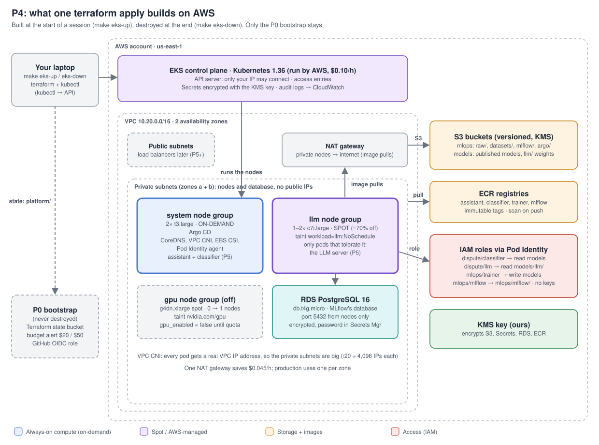
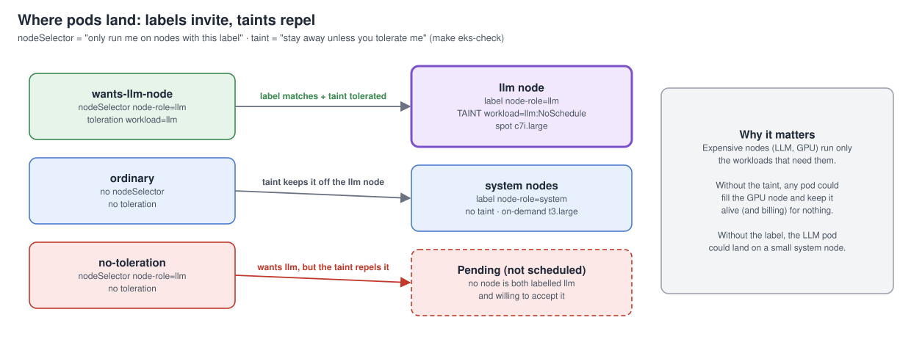

# P4: The platform in Terraform (VPC, EKS, node groups, storage, RDS, Argo CD)

Part of [PLAN.md](../PLAN.md) §5. **Status (2026-11-16): done.** Applied, verified, and used by P5. Results and findings at the end. First phase that costs money.

**Goal:** one `make eks-up` builds the whole AWS side; one `make eks-down` removes it, and a script proves nothing was left behind.



**Why now:** P1–P3 run on a laptop. Everything after this (KServe serving, GPU, autoscaling, canaries, incident drills) needs a real cluster. This phase builds it as code, so it can be created for a session and destroyed after, which is how a $50/month budget covers a whole EKS project.

---

## Cost (us-east-1, while it exists)

| Item | Per hour | Why it's there |
| --- | --- | --- |
| EKS control plane | $0.10 | AWS runs the Kubernetes API for us |
| 2× t3.large system nodes (on-demand) | $0.17 | add-ons, Argo CD, assistant, classifier |
| 1× c7i.large LLM node (spot) | ~$0.03 | the LLM server (Plan B: CPU) |
| NAT gateway | $0.045 + $0.045/GB | private nodes reach the internet (image pulls) |
| RDS db.t4g.micro + 20 GB | ~$0.02 | MLflow's database |
| EBS, KMS key, Secrets Manager secret, logs | ~$0.01 | |
| **Total** | **≈ $0.36/hour** | a 3-hour session ≈ $1–1.50 incl. image pulls |

Forgotten overnight: ~$8.60/day. Guards: the $20 budget alert (P0), and `make eks-down` ends every session with `leftovers.sh`.

---

## What we build

| Piece | What it is | File |
| --- | --- | --- |
| **VPC** | 10.20.0.0/16 in 2 availability zones; public subnets (NAT gateway, future load balancers) and large private subnets (nodes, RDS) | [vpc.tf](../../infra/platform/vpc.tf) |
| **EKS 1.36** | Control plane; API reachable only from your IP; access entries; Secrets encrypted with our KMS key; audit logs | [eks.tf](../../infra/platform/eks.tf) |
| **Node group `system`** | 2× t3.large on-demand, label `node-role=system` | eks.tf |
| **Node group `llm`** | spot c7i/c6i/m7i.large, 1–2 nodes, label `node-role=llm`, **taint** `workload=llm:NoSchedule` | eks.tf |
| **Node group `training`** (added in P5) | spot, same 11 types, label `node-role=training`, taint `workload=training:NoSchedule` | eks.tf |
| **Node group `gpu`** (off) | spot g4dn.xlarge, 0–1 nodes, NVIDIA AMI, taint `nvidia.com/gpu`; created only with `gpu_enabled = true` | eks.tf |
| **Add-ons** | VPC CNI, Pod Identity agent, kube-proxy, CoreDNS, EBS CSI driver | eks.tf |
| **KMS key** | one customer-managed key for S3, Kubernetes Secrets, RDS, ECR | [storage.tf](../../infra/platform/storage.tf) |
| **S3 buckets** | `mlops` and `models`, same layout as SeaweedFS in P2; versioned, KMS, public access blocked, old versions expire after 30 days | storage.tf |
| **ECR** | `assistant`, `classifier`, `trainer`, `mlflow`; immutable tags, scan on push, keep last 20 | storage.tf |
| **Pod Identity roles** | classifier: read published models · llm: read `llm/` weights · trainer: read/write `mlops`, publish to `models` · mlflow: `mlops/mlflow/` · EBS CSI driver | [pod_identity.tf](../../infra/platform/pod_identity.tf) |
| **RDS PostgreSQL 16** | db.t4g.micro, private subnets, only reachable from EKS nodes, encrypted, password created by RDS in Secrets Manager | [rds.tf](../../infra/platform/rds.tf) |
| **Argo CD** | Helm chart 10.11.6 on the system nodes, installed by Terraform | [argocd.tf](../../infra/platform/argocd.tf) |

## New words

| Word | Meaning, with our example |
| --- | --- |
| **VPC / subnet** | Your own private network in AWS, split into subnets per availability zone. *Public* subnets route to the internet directly; *private* ones don't |
| **NAT gateway** | Lets machines in private subnets make outgoing connections (pull images) while nothing on the internet can connect in |
| **Availability zone (AZ)** | A separate data centre within a region (us-east-1a, 1b…). Two AZs = survives one data-centre failure |
| **Control plane** | The Kubernetes API server, scheduler and etcd. On EKS, AWS runs it ($0.10/h); you run only the nodes |
| **Node group (managed)** | A set of identical worker machines EKS creates and updates for you, from an EC2 Auto Scaling group |
| **On-demand vs spot** | On-demand: full price, yours until you stop it. Spot: AWS's spare capacity, ~70% cheaper, but AWS can take it back with 2 minutes' notice |
| **Label / nodeSelector** | A label is a tag on a node (`node-role=llm`); a pod's `nodeSelector` says "only run me on nodes with this label" |
| **Taint / toleration** | A taint on a node *repels* pods (`workload=llm:NoSchedule`); only pods with a matching *toleration* may run there. Label = "come here", taint = "stay away unless invited" |
| **EKS accelerated AMI** | The machine image for GPU nodes, with the NVIDIA driver and container toolkit already installed (`AL2023_x86_64_NVIDIA`) |
| **Add-on** | Cluster software AWS installs and upgrades for you (networking, DNS, storage driver) |
| **VPC CNI** | The network plugin: every pod gets a real IP address from the VPC. That's why the private subnets are big (/20 = 4,096 addresses each) |
| **Access entry** | How EKS decides which IAM users/roles may use the cluster (replaces the old `aws-auth` ConfigMap) |
| **Pod Identity** | Maps a Kubernetes service account to an IAM role; its pods get temporary AWS credentials. Replaces the S3 keys we kept in Secrets in P2 |
| **KMS key** | An encryption key managed by AWS KMS. "Customer-managed" = ours, with our own policy and rotation |
| **Terraform module** | A reusable package of Terraform code. We use the community `terraform-aws-modules` for VPC and EKS (≈40 and ≈60 resources each), and write the rest ourselves |
| **Remote state / state key** | The P0 bucket holds both stacks' state under different keys: `bootstrap/` (never destroyed) and `platform/` (destroyed every session) |

### Where pods land



## Design choices worth defending

| Choice | Why | What production would do |
| --- | --- | --- |
| Two stacks: bootstrap and platform | The state bucket, budget and OIDC must survive a destroy; the platform must not survive the evening | Same split, plus one platform stack per environment (dev/staging/prod) |
| `plan -out` then `apply` that file | You apply exactly what you reviewed, nothing that changed in between | The same, in CI: plan on the PR, apply the saved plan after approval (P7) |
| One NAT gateway | $0.045/h instead of $0.09/h | One per AZ, so a zone outage doesn't cut the other zone off |
| System nodes on-demand, LLM nodes spot | Add-ons and Argo CD shouldn't disappear; the LLM pod can be rescheduled | The same split; spot for stateless and retryable work (inference replicas, training with checkpoints) |
| Three instance types for spot | More pools to draw from = fewer "no capacity" failures | Same, often 5–10 types, chosen by Karpenter (P9) |
| Taint on LLM and GPU nodes | Expensive nodes run only the workloads that need them; nothing else "fills" a GPU node and keeps it alive | The same; the standard pattern for GPU pools |
| GPU group behind `gpu_enabled`, min 0 | The quota is 0 today; when approved it's one variable, and it costs nothing until a GPU pod asks | The same |
| API endpoint public, limited to your IP | Simple for a laptop, still not open to the world | Private endpoint, reached over VPN, a bastion or CI runners inside the VPC (P11) |
| Pod Identity, not IRSA | Newer and simpler: no OIDC provider per cluster, no annotations; the association can exist before the service account | Either; Pod Identity for new clusters |
| `force_destroy`, no final snapshot, no deletion protection | A lab must destroy cleanly every evening | All three the other way round |
| Versions pinned (EKS 1.36, modules, chart) | N-1 for EKS so add-ons and charts have caught up; pinned modules so a plan doesn't change by itself | The same, with a monthly upgrade window |

## Files

```
infra/platform/
├── versions.tf      providers (aws ~> 6.70.0, helm ~> 3.3.0), state key platform/
├── variables.tf     region, name, EKS version, admin_cidrs, gpu_enabled, mlflow_db_enabled, argocd_enabled
├── vpc.tf           network
├── eks.tf           cluster, add-ons, node groups
├── storage.tf       KMS key, S3 buckets, ECR
├── pod_identity.tf  IAM roles per service account + associations, EBS CSI role
├── rds.tf           PostgreSQL for MLflow
├── argocd.tf        Argo CD Helm release
├── outputs.tf       kubeconfig command, ECR URLs, buckets, roles, DB endpoint
└── leftovers.sh     after destroy: lists anything still there
deploy/eks/placement-test.yaml   the taint/toleration check
```

## Steps

1. `make eks-plan`: init, then plan with your current IP; review the output. *(Done: 101 to add.)*
2. **Confirm the account can run EKS** (the Free plan restricts some services) and that the budget alert is active.
3. `make eks-up`: apply the saved plan (≈15–20 minutes: EKS ~10, RDS ~5), then add the cluster to kubeconfig.
4. `make eks-check`: nodes with their roles and capacity types, then the placement test.
5. Look around: `kubectl get pods -A`, Argo CD (`kubectl -n argocd port-forward svc/argocd-server 8081:80`), the S3 buckets and ECR in the console.
6. `make eks-down`, then read `leftovers.sh` output: nothing under any heading.
7. Write up results here.

## Drills

| # | Do | Expected | Proves |
| --- | --- | --- | --- |
| 1 | `make eks-check` | `wants-llm-node` → an `llm` node; `ordinary` → a `system` node; `no-toleration` stays **Pending** | Taints keep expensive nodes for the workloads that need them |
| 2 | `kubectl get nodes -L eks.amazonaws.com/capacityType` | system = ON_DEMAND, llm = SPOT | Capacity types as designed |
| 3 | Pod Identity: a pod with service account `dispute/classifier` runs `aws s3 ls` on `models` (works) and `mlops` (AccessDenied) | Least privilege without any keys | |
| 4 | `make eks-down` then `leftovers.sh` | Every heading empty | The session really cost nothing after it ended |
| 5 (after GPU approval) | `gpu_enabled = true`; a pod requesting `nvidia.com/gpu: 1` runs `nvidia-smi`; delete it | The GPU node appears, then scales back to 0 | We pay for a GPU only while a model needs it |

---

## Done when

- [x] `make eks-up` builds the cluster from nothing; `kubectl get nodes` shows 2 system + 1 llm node.
- [x] Drill 1: the tolerating pod lands only on the LLM node group; the others don't.
- [x] Drill 3: Pod Identity gives the classifier read access to `models` and nothing else.
- [x] Argo CD is running.
- [ ] `make eks-down` removes everything; `leftovers.sh` is empty.
- [ ] (After GPU approval) drill 5.

## Interview story

> "The platform is two Terraform stacks: a small bootstrap that never goes away (state bucket, budget, keyless CI access), and the platform itself, which I build at the start of a session and destroy at the end, with a script that proves nothing was left running. EKS has three node groups for three kinds of work: on-demand system nodes, a tainted spot pool for the LLM, and a GPU pool behind a flag that scales from zero. Pods get AWS access through Pod Identity, scoped per service account, so serving can read published models and nothing else, and no keys exist anywhere."

---

## Laptop → EKS: what changes for P1–P3

| On kind (P1–P3) | On EKS (P4 builds it, P5 uses it) |
| --- | --- |
| One node does everything | Three node groups; the LLM pod tolerates the `llm` taint |
| Images loaded with `kind load` | Images pushed to ECR (tag = git SHA) |
| SeaweedFS with keys in Secrets | S3 buckets with Pod Identity roles: no keys |
| PostgreSQL pod | RDS PostgreSQL |
| `make deploy` (Helm by hand) | Argo CD syncing from Git (P7) |
| Model file mounted from the laptop | LLM weights in `s3://…-models-…/llm/`, read by the `llm` service account (P5) |

---

## What happened (real results, 2026-11-16)

**Apply:** 101 resources from nothing, no errors. EKS control plane 11 min 28 s, node groups 2–3 min after, RDS 8 min 13 s (in parallel), Argo CD 1 min. `make eks-plan` right after: no changes (no drift).

| Check | Result |
| --- | --- |
| Nodes | 2× t3.large ON_DEMAND (`system`) in us-east-1a and 1b, 1× SPOT (`llm`); Kubernetes 1.36.5 |
| Placement drill | `wants-llm-node` → llm node; `ordinary` → system node; `no-toleration` → **Pending** |
| Pod Identity drill | classifier: list `models` allowed, write `models` **denied**, list `mlops` **denied**; trainer: write `mlops` allowed. Identity: `assumed-role/llm-platform-classifier/…` |
| EKS settings | API public only to your IP `/32`; Secrets encrypted (KMS); audit logs; access entries (`API` mode) |
| Network | nodes have no public IPs; 2 public /24 and 2 private /20 subnets in 2 zones; 1 NAT gateway |
| Storage | both buckets versioned, `aws:kms`, public access blocked; 4 ECR repos `IMMUTABLE`, scan on push, KMS; KMS key `CUSTOMER`, rotation on |
| RDS | PostgreSQL 16.13, db.t4g.micro, **not publicly accessible**, encrypted; only inbound rule: 5432 from the node security group |
| Argo CD | 5 pods Running, all on system nodes |
| Only per-node agents on the LLM node | networking, storage driver, Pod Identity agent: they tolerate every taint; nothing else landed there |

### Findings

1. **The spot node was reclaimed after 13 minutes and couldn't be replaced.** At 17:22 the LLM node got a spot interruption notice; the Auto Scaling group then failed 20+ times with `UnfulfillableCapacity`. Spot placement scores (AWS's 1–10 estimate of getting capacity): **1–2** for our 3 instance types, **9** in every zone for 11 similar 2-vCPU types. Fix: `llm_instance_types` widened to 11 (applied in P5; the new group came up on c5.large). Lesson: **diversify spot across many instance types**; that is what Karpenter does automatically (P9). An interruption is also why serving needs 2 replicas across pools in production.
2. **The account's plan didn't block EKS.** The CLI and boto3 were too old to report Free vs Paid, so the apply itself was the test; EKS creation was accepted.
3. **Everything else matched the plan on the first apply**: modules pinned, plan reviewed and applied as a saved file, no drift afterwards.
