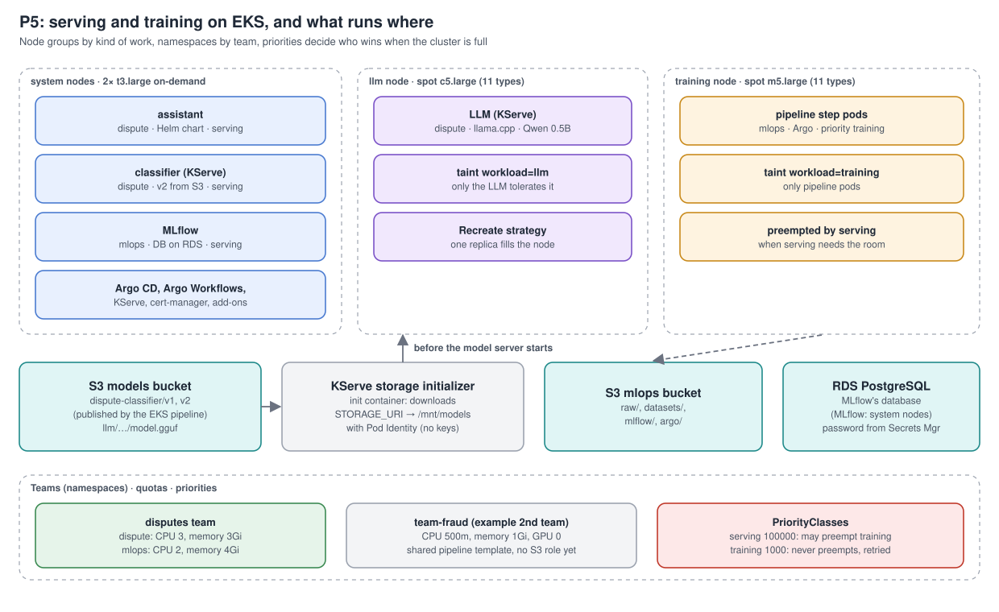

# P5: Serving and training on EKS (KServe, Argo Workflows, teams, priorities)

Part of [PLAN.md](../PLAN.md) §5. **Status (2026-11-16): done on CPU (Plan B).** GPU/vLLM waits for the quota. Results and findings at the end.

**Goal:** run the whole P1–P3 system on the P4 cluster the way a platform team would. Both models are served by KServe and load their weights from S3. The training pipeline runs on spot nodes and publishes to S3. Several teams share the cluster with caps and priorities.

**Cost:** the P4 cluster (~$0.36/h) plus a spot training node (~$0.03/h) while it's up. The whole P5 session, building and testing, took about 1.5 hours, ≈ $0.60.

---

## What we build

| Part | Piece | What it is | File |
| --- | --- | --- | --- |
| 1 serving | **Images in ECR** | assistant, classifier, trainer, mlflow, built for **linux/amd64** (the Mac is ARM), tagged with the git commit | `docker buildx … --platform linux/amd64` |
| 1 | **Models in S3** | `models/dispute-classifier/v<N>/` (published by the pipeline) and `models/llm/qwen2.5-0.5b-instruct-q4_k_m/model.gguf` | |
| 1 | **cert-manager + KServe** | KServe v0.21.0 in **Standard** mode: a plain Deployment + Service per model, no Knative or Istio | [deploy/eks/install-serving.sh](../../deploy/eks/install-serving.sh) |
| 1 | **Classifier `InferenceService`** | Our own server image; KServe's **storage initializer** downloads the model from S3 into `/mnt/models` using Pod Identity; our server still checks the checksum | [deploy/eks/inference-services.yaml](../../deploy/eks/inference-services.yaml) |
| 1 | **LLM `InferenceService`** | llama.cpp pinned by digest (the image tested in P1), on the tainted spot LLM node, weights from S3 | same file |
| 1 | **Assistant** | The P1 Helm chart with an EKS values file (node group, priority, KServe service names) | [deploy/eks/assistant.yaml](../../deploy/eks/assistant.yaml) |
| 2 training | **`training` node group** | spot, the same 11 instance types, tainted `workload=training` | [infra/platform/eks.tf](../../infra/platform/eks.tf) |
| 2 | **MLflow on RDS** | Same image as P2; database = RDS, password from Secrets Manager into a Kubernetes Secret (never printed); files in the real `mlops` bucket via Pod Identity | [deploy/eks/mlflow.yaml](../../deploy/eks/mlflow.yaml), [install-training.sh](../../deploy/eks/install-training.sh) |
| 2 | **Argo Workflows** | Same chart as P2; step files in real S3 with `useSDKCreds` (Pod Identity), watching two team namespaces | [deploy/eks/argo-values.yaml](../../deploy/eks/argo-values.yaml) |
| 2 | **Shared pipeline template** | The P2 pipeline as a **ClusterWorkflowTemplate**: any team namespace runs it with its own parameters | [deploy/eks/train-classifier.yaml](../../deploy/eks/train-classifier.yaml) |
| 3 teams | **PriorityClasses** | `serving` (100000) may preempt; `training` (1000) never preempts and is evicted first | [deploy/eks/teams.yaml](../../deploy/eks/teams.yaml) |
| 3 | **Team namespaces + ResourceQuota + LimitRange** | disputes team: `dispute` (CPU 3, memory 3Gi) and `mlops` (CPU 2, memory 4Gi); example second team `team-fraud` (CPU 500m, memory 1Gi, GPU 0) | same file |

## New words

| Word | Meaning, with our example |
| --- | --- |
| **KServe** | A Kubernetes add-on for serving models. You describe a model as an `InferenceService`; KServe creates the Deployment, Service and model download for you |
| **InferenceService (ISVC)** | KServe's object: "serve this model, from this storage URI, with this server". Ours: `classifier` and `llm` in namespace `dispute` |
| **Standard (raw) mode** | KServe without Knative: ordinary Deployments and Services. Simpler; no scale-to-zero (that's Knative's feature) |
| **Storage initializer** | An init container KServe adds that downloads `STORAGE_URI` (e.g. `s3://…/dispute-classifier/v2/`) to `/mnt/models` before the server starts. It replaces our own `fetch_model.py` from P2 |
| **Custom predictor** | Using your own server image in an ISVC instead of KServe's built-in runtime (e.g. its generic scikit-learn server). We keep ours for its checksum and framework checks |
| **Cold start** | Time from "pod scheduled" to "ready to answer": node ready + image pull + model download + model load |
| **TTFT / tokens per second** | Time to first token (how long before the reply starts) and generation speed. The two numbers that describe LLM serving performance |
| **Prompt cache** | llama.cpp reuses work for a prompt it has already seen. Benchmarks must turn it off (`cache_prompt: false`) or TTFT looks unrealistically good |
| **ClusterWorkflowTemplate** | An Argo pipeline definition available to every namespace (a WorkflowTemplate is per namespace) |
| **PriorityClass / preemption** | A pod's priority. When a high-priority pod can't fit, the scheduler **preempts** (evicts) lower-priority pods to make room |
| **preemptionPolicy: Never** | This pod waits for room instead of evicting anyone (our `training` class) |
| **ResourceQuota** | A cap per namespace on the total CPU, memory, GPUs and pods its pods may *request* |
| **LimitRange** | Default requests/limits for containers that declare none. Needed with a quota, which rejects pods without requests |
| **Recreate strategy** | Stop the old pod before starting the new one. Needed when one replica fills its node, or a rolling update waits forever for room |

## Design choices worth defending

| Choice | Why |
| --- | --- |
| KServe Standard mode, not Knative | No Istio/Knative to run and debug; we don't need scale-to-zero for always-on serving. Knative or KEDA can add it later (P9) |
| Our own server image inside KServe | Keeps the P2 safety checks (checksum, framework) and our API; KServe still provides the download, Service and lifecycle |
| Images pinned by commit tag or digest | ECR tags are immutable; llama.cpp is pinned to the exact digest tested on the laptop (multi-arch: amd64 + arm64) |
| Same code, only configuration differs | The training code reads `S3_ENDPOINT_URL`, `MLOPS_BUCKET`, `MODELS_BUCKET`; empty endpoint = real S3. Same results on both platforms (below) |
| Database password from Secrets Manager into a Kubernetes Secret by script | Never in Git or Terraform state. Production: **External Secrets Operator** syncs and rotates it |
| One shared pipeline template, per-team namespaces | Teams don't build their own pipelines; the platform owns one, versioned |
| Serving preempts training, never the reverse | Customers aren't kept waiting; a training step is retried or re-created, which costs only time |
| Quotas start small for a new team | Raising a quota is a reviewed change and a cost decision |

## Steps (as run)

1. P4 spot fix: 11 instance types for the LLM node group (see P4 findings).
2. Build amd64 images, push to ECR; copy classifier v2 and the GGUF to S3.
3. `deploy/eks/install-serving.sh`: cert-manager, KServe. Apply the InferenceServices; deploy the assistant.
4. Smoke test, LLM speed, golden-set eval against EKS.
5. Terraform: `training` node group. Push trainer and MLflow images; upload raw exports to S3.
6. `deploy/eks/install-training.sh`: teams, quotas, priorities, MLflow on RDS, Argo Workflows, the shared template.
7. Pipeline runs on EKS (November → v1, December → v2); point the classifier at the pipeline's v2.
8. Team drills: quota, data isolation, preemption.

Make targets: `make eks-serving`, `make eks-training`, `make eks-train RAW=<file> [TEAM_NS=team-fraud]`.

---

## Done when

- [x] Classifier and LLM served by KServe, weights loaded from S3 with Pod Identity; the LLM runs only on the LLM node group.
- [x] The assistant answers end to end on EKS, and the P3 golden-set gate passes there.
- [x] TTFT and tokens/sec measured on the CPU node (GPU comparison after the quota).
- [x] The training pipeline runs on spot training nodes, writes to S3 and MLflow-on-RDS, and the classifier serves the version it published.
- [x] A second team can run the shared template from its own namespace, within its quota, without access to the first team's data.
- [x] When the cluster is full, serving preempts training and the training step still completes.
- [ ] (After GPU approval) vLLM with Qwen2.5-1.5B on the GPU node, `dtype=half`, and the CPU vs GPU comparison.
- [ ] (P9) Weights cached on a volume to cut cold start further; autoscaling.

## Interview story

> "On EKS both models are KServe InferenceServices. KServe's storage initializer pulls the exact model version from S3 with Pod Identity, so images hold no weights and no keys. The training pipeline is a shared Argo ClusterWorkflowTemplate on spot nodes; it produced the same dataset version and the same scores as on my laptop, published v2 to S3, and the classifier serves it with full lineage. Teams get namespaces with quotas, and serving has priority over training. I tested it: a serving pod preempted a running training step, the step waited, and the run still succeeded. The first spot node was reclaimed after 13 minutes and couldn't be replaced with three instance types; widening to eleven took the placement score from 1–2 to 9."

---

## Laptop → EKS: what changed

| On kind (P1–P3) | On EKS (P5) |
| --- | --- |
| `kind load` images (arm64) | ECR, built for amd64 |
| Classifier: our `fetch_model.py` init container | KServe storage initializer |
| SeaweedFS + keys in Secrets | S3 + Pod Identity, no keys |
| PostgreSQL pod | RDS PostgreSQL |
| `WorkflowTemplate` in `mlops` | `ClusterWorkflowTemplate`, run from any team namespace |
| One node | System / LLM / training node groups, taints, priorities, quotas |
| Phoenix tracing | Not deployed on EKS yet (P8 brings the observability stack) |

---

## What happened (real results, 2026-11-16)

### Serving

| Check | Result |
| --- | --- |
| Classifier ISVC | Ready; model downloaded by the storage initializer with Pod Identity |
| LLM ISVC | Ready on the spot LLM node (c5.large). Pod start: scheduled → model downloaded (469 MB in **4.4 s**) at 13 s → server started 23 s → **ready 26 s** |
| End to end | `/assist` → right dispute types, policy-based replies, classifier lineage `version 2` |
| LLM speed (2 CPU threads, cache off) | **~20 tokens/s** generation (same as the laptop); **TTFT 1.1 s** for an 80-token prompt (laptop 2.3 s) |

**Golden-set gate on EKS: passed.**

| Metric | Laptop (P3) | EKS |
| --- | --- | --- |
| Accuracy | 0.67 | 0.68 |
| Fact coverage | 0.63 | 0.61 |
| PII leaks / refund promises | 0 / 0% | 0 / 1.7% |
| Latency p50 / p95 | 8.7 s / 13.4 s | **6.3 s / 9.5 s** |
| Errors | 0 | 1 timeout (1.7%) |

### Training

| Run | Where | Result |
| --- | --- | --- |
| November raw drop | spot m5.large, priority `training` | all 5 steps in **1 min 49 s**; scikit-learn 0.979 vs PyTorch 0.970 (val); test macro-F1 **0.9869** (same as on kind); **v1** published to S3 |
| December raw drop | same | **v2** promoted (tie on golden, as in P2) and published |
| Classifier after restart | `dispute` | serves `version 2, dataset 6e375f7616ed, commit fe78dd5`: the **same dataset version** as on the laptop |

### Teams and priorities

| Drill | Result |
| --- | --- |
| team-fraud requests 1 CPU (quota 500m) | **Forbidden**: `exceeded quota: compute, requested: requests.cpu=1, limited: requests.cpu=500m`. A 200m pod is admitted, and the LimitRange fills in its memory (64Mi / 256Mi) |
| team-fraud runs the shared template | Uses the template fine; stops at the first step with `NoCredentialsError`: its `trainer` has no AWS role, so it can't read the disputes team's data. Access must be granted on purpose (per-team roles and prefixes: P11) |
| Preemption | 18:17:17 train step starts → 18:17:22 a `serving` pod that needs the training node **preempts it** → 18:17:27 Argo re-creates the step pod, `Pending: Insufficient cpu` (training never preempts) → burst ends → 18:17:48 scheduled again → run **Succeeded** |

### Findings (good interview material)

1. **Images must match the node's CPU architecture.** Built on an ARM Mac, run on x86 nodes: `docker buildx --platform linux/amd64`. A mismatch fails at start with `exec format error`.
2. **KServe adds a default CPU limit of 1 core.** The LLM requested 1.5 cores, and the Deployment was rejected (`requests must be <= cpu limit of 1`). Set limits explicitly.
3. **A single replica that fills its node can't roll.** A rolling update starts the new pod first, and it can never fit. `deploymentStrategy: Recreate` (a short gap) until P9 adds a second replica.
4. **KServe's Istio warning:** in Standard mode without Istio, `disableIstioVirtualHost=true` stops a reconcile error on every change.
5. **The prompt cache makes benchmarks lie.** A repeated prompt showed TTFT 50 ms (1 token processed). With the cache off: 1.1 s.
6. **`templateDefaults` didn't apply through a ClusterWorkflowTemplate reference** (Argo v4.1.5): the first run failed with `image may not be empty` before any pod existed. Fixed with a YAML anchor merged into each step, which is clearer anyway.
7. **A test leftover blocked Helm.** The P4 Pod Identity test created `mlops/trainer`; Helm refused to adopt it (`invalid ownership metadata`). Lesson: things a chart manages should only ever be created by the chart.
8. **Same code, same data, same dataset version.** The content-hash versioning from P2 gave `6e375f7616ed` on both platforms: real reproducibility, and a strong lineage story.
9. **Argo v4 re-creates a preempted pod inside the same attempt.** The retry budget wasn't used; the step just waited and ran. The retry policy (pod lost / exit 137) is still the backstop for a spot node disappearing.
10. **Isolation by default works.** A second team can use the shared template but gets no AWS credentials until a role is mapped to its service account.
